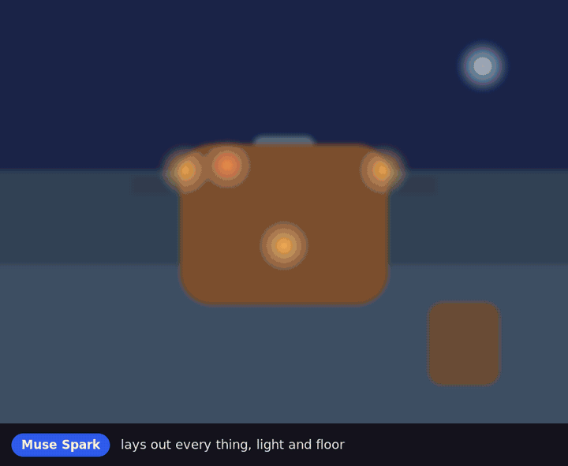
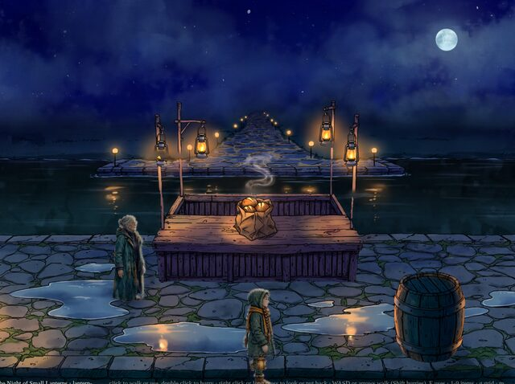
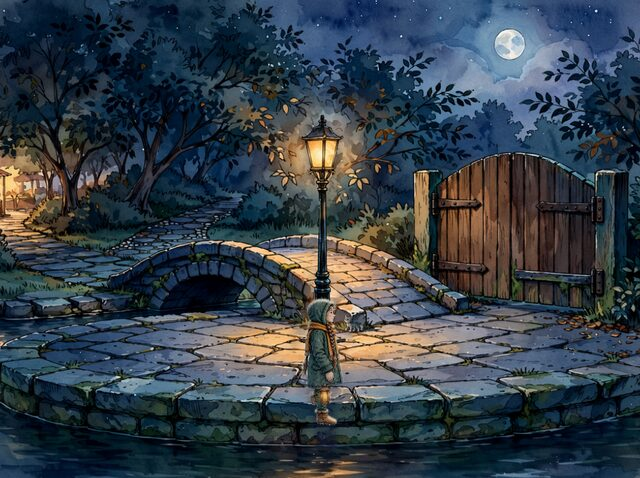
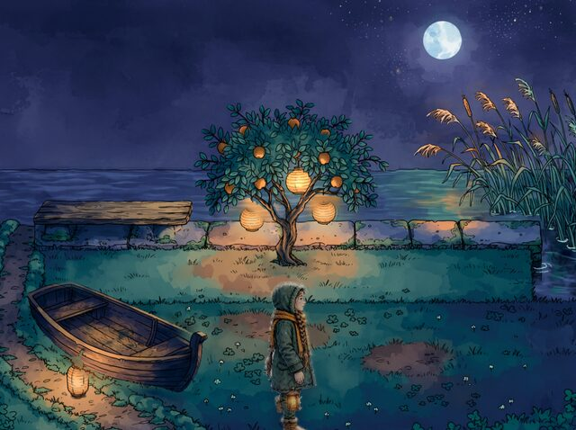
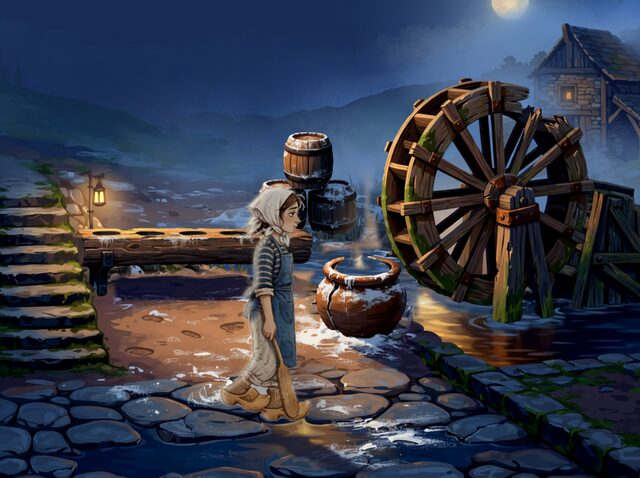
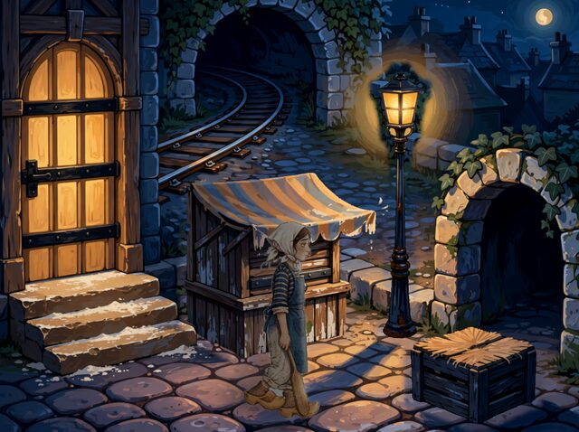
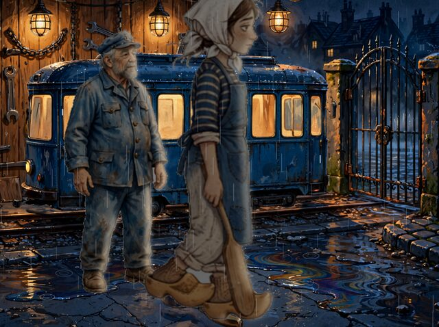
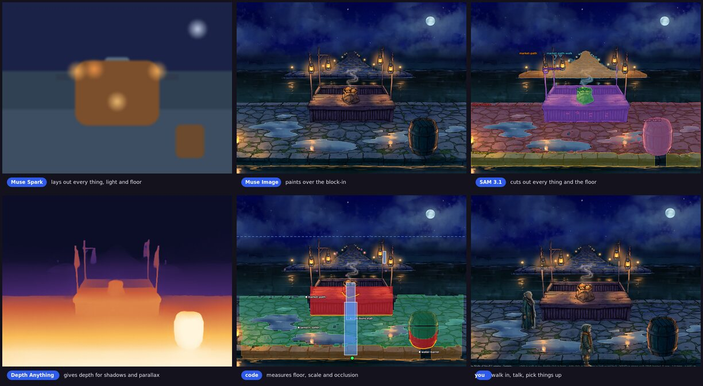
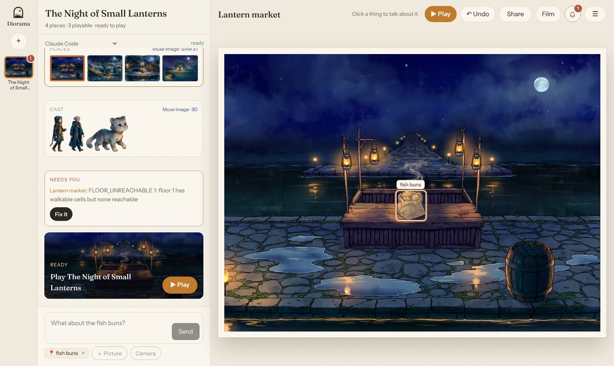

# Diorama

**Type one sentence. Walk around in the painted game it becomes.**

<p align="center">
  
</p>

Diorama is a local tool that turns a story idea into a small point-and-click adventure: painted places, a hero and characters who walk and talk, things to pick up and use, sound and voices, and endings that are checked to be reachable. Meta's models do the creative work; code measures and checks every result, so what comes out is playable, not only pretty. Every step writes plain files, and every fix you make survives the next rebuild.

## Quick start

Node 22+, `ffmpeg`, and a Meta Model API key:

```sh
git clone https://github.com/gtanczyk/diorama && cd diorama && npm install
npm run setup                                   # what this machine still needs; keys are typed hidden
npm run studio                                  # the GUI on 127.0.0.1
npm run build -- lanterns "A girl with a candle lantern looks for her lost cat at a night market by a canal."
npm run play -- lanterns                        # http://localhost:4173
```

More in [docs/setup.md](docs/setup.md): optional keys (ElevenLabs for sound, Hugging Face for 3D), sharing a world on GitHub Pages or itch.io.

## Made with Diorama

<table>
<tr>
<td width="33%"></td>
<td width="33%"></td>
<td width="33%"></td>
</tr>
<tr><td colspan="3"><b>The Night of Small Lanterns</b>: <i>"A small night market by a canal: a lantern seller's stall lit by hanging oil lanterns, a street lamp by a little bridge. A girl carrying a candle lantern must find her lost cat before the lanterns go out."</i></td></tr>
<tr>
<td></td>
<td></td>
<td></td>
</tr>
<tr><td colspan="3"><b>Midnight Crust</b>: <i>"A night-shift baker in a tiny Kraków bakery must find the lost sourdough starter before the morning rush, helped by a grumpy tram driver."</i></td></tr>
</table>

Each is a four-place world built from that one sentence: about 17 minutes of steps and some 200 Meta model calls, with no hand edits.

## Meta models at work

| Model | What it does in Diorama |
| --- | --- |
| **Muse Spark** | Designs the world and the story, lays out each place as a colour block-in, critiques paintings, names what to cut out, plans the sound, judges playthroughs |
| **Muse Image** | Paints each place over its block-in, repaints only the regions the critic flags, paints the cast, their walk and talk sheets and inventory icons |
| **SAM 3.1** | Cuts every thing, floor, stair, puddle and patch of water out of the painting; the masks become the walk grid, occlusion and pick-ups |
| **Muse Voice Transcribe** | Hears an idea you say aloud, and listens to every voiced line to catch a take that does not say it |
| **Muse Code** | The Studio's agent: it fixes a world with you through the same actions as the GUI |

Also used: Depth Anything V2 (ONNX, on the CPU) for shadows and parallax, ElevenLabs for voices and effects, MusicGen (open weights, run locally) for music, and TRELLIS with Make-It-Animatable on Hugging Face for the characters' 3D models.

## How a place is made

<p align="center"></p>

1. **world, story**: Spark turns the sentence into places, a cast, items, locks and endings, and checks every ending can be reached.
2. **layout, paint**: Spark lays out each place as a block-in; Muse paints over it; a Spark critic marks what is wrong and Muse repaints only those regions.
3. **masks, plates**: SAM 3.1 cuts out every thing and floor; Muse paints the place without the things the hero can take.
4. **derive, backdrop, weather**: code measures floor, scale, occlusion, stairs and light from the masks and the depth map; the place becomes a little stage with cards, far flats, moving water, rain and drips.
5. **cast, model, sprites**: the hero and characters are painted, cut out, turned into 3D models and drawn back as sprite sheets in the world's style.
6. **sound, voices**: ambience, loops, footsteps and music; a fitting voice for every character.
7. **verify**: every place is walked and used by code; places that fail are repaired automatically, or handed to the agent with what is wrong.

Model answers are memoised by a hash of their inputs, so running a step again with the same inputs is free.

## Studio

`npm run studio` opens the GUI on 127.0.0.1: describe a world (type it, say it, or add a photo of a real room or person), watch it build place by place, play it, and fix it by talking to the agent that looks after the world: click a thing on the stage and say what should change. Everything it does is an action that the page, the terminal (`diorama action`) and the agent (`diorama mcp`) share. See [docs/studio.md](docs/studio.md).

<p align="center"></p>

## Commands

| | |
| --- | --- |
| `diorama build <slug> "<idea>"` | every step, world to verify (`--from`, `--to`, `--place`, `--photo`, `--hero-photo`) |
| `diorama play <slug>` | serve the game on localhost |
| `diorama studio [slug]` | the GUI |
| `diorama style <slug> "<style>"` | repaint a finished world in another style |
| `diorama playthrough <slug> --video` | play every ending in the browser and record it |
| `diorama publish <slug>` / `export <slug> --zip` | GitHub Pages link / a zip for itch.io |
| `diorama` | all commands; each step also runs alone |

## Docs

- [Setup and sharing](docs/setup.md)
- [Studio](docs/studio.md)
- [Places: depth, weather and the play page](docs/scenes.md)
- [Characters, style and icons](docs/characters.md)
- [Sound and voices](docs/sound.md)

## Built at the Meta AI Global Hackathon

Everything in this repository was written during the hackathon, from the kickoff on 26 October 2026; the commit log is the history. Earlier work is used only as declared dependencies in `package.json`, including [genaicode](https://github.com/gtanczyk/genaicode), the author's own open-source package that gives the Studio its agent chat panel.

## License

Apache-2.0
