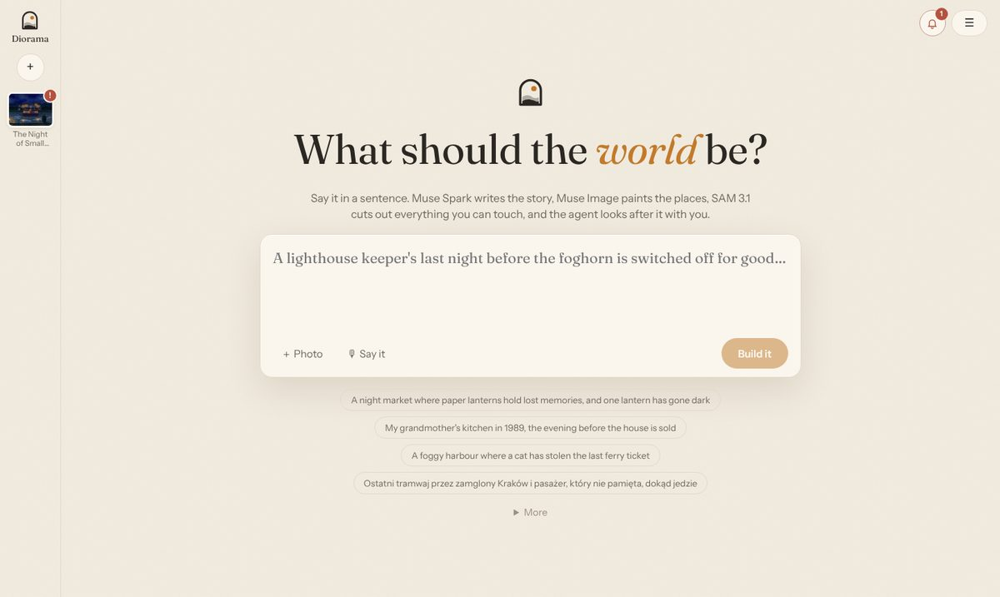
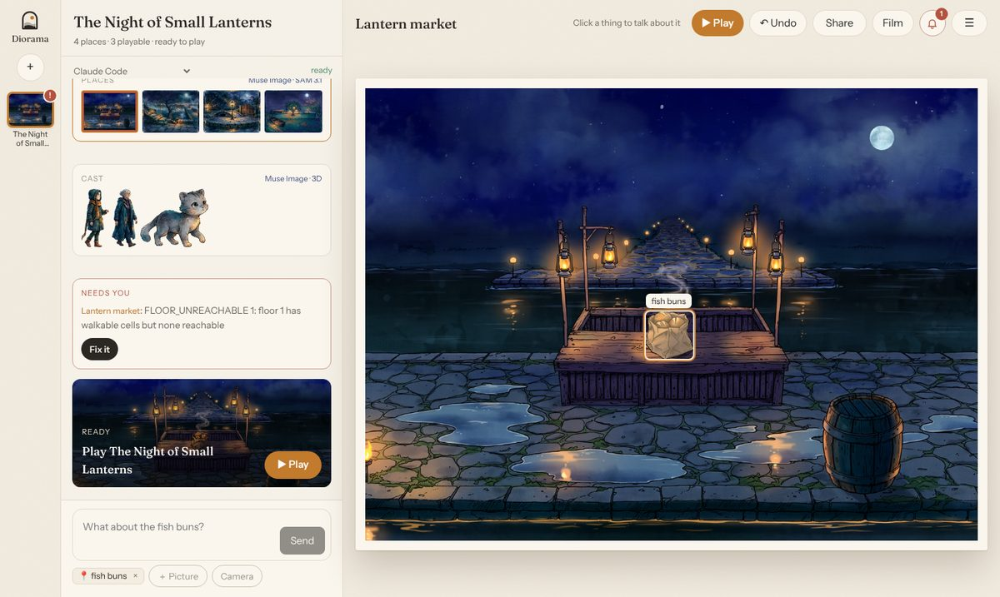

# Studio

`diorama studio [slug]` opens the GUI: describe a world (type it, say it with 🎙, or add photos with ＋ Photo or 📷 Camera, up to 16, one after another: a real room becomes the first place, a person the hero, drawings the characters, things and places they show) and watch it build, place by place, with every step, model call and verify finding live. It listens on 127.0.0.1 only and opens through the one-time link it prints. Everything it does is an action, also runnable as `diorama action <name> '<json>'` (`diorama action` lists them), so a terminal, the page and the Muse Code agent drive the same things. The terminal running the Studio prints what runs (`--verbose` for every job line, `--quiet` for none).

The Studio is an atelier. Its home is one big prompt ("What should the world be?"): one Spark call (action `world_new`) picks the world's title and folder name, how many places the story needs (2 to 5: only what it needs) and the language it is written in. A spoken idea is heard by Muse Voice Transcribe (`idea_hear`). Every world sits in the rail on the left as its painting, with a ring while it builds and a red **!** when it waits for you; the bell gathers what is building, what failed and what finished since you last looked.

A world is a conversation with the agent that looks after it, beside a stage. The conversation tells the world in cards: the idea, the **Story**, the **Places** as small paintings, the **Cast** in a row, **Needs you** when a place is not playable (**Fix it** hands it to the agent), what each turn **Changed**, the build while it runs (click a phase of its bar, or one step's segment, to put what it made on the stage: the story, a place's painting, cut-outs or walk grid, the cast, the game), and **Play**. A card puts what it is about on the stage. Point at a thing in the painting and its SAM mask lights up; click it, or a character in the cast, and it goes into the next message ("What about the fish buns?"), so you talk about *this* instead of naming masks. **＋ Picture** and **Camera** add a photo or a drawing to a message. When the agent needs you to decide (rebuild this place? which of two fixes?), it asks with `ask_person` and the question comes as a card with buttons; a tap is your answer.

**▶ Play**, **↶ Undo**, **Share** and **Film** (the stage alone on the whole screen, for recording) are always in the stage's top bar. The ☰ menu holds History, Style, Build again, Activity (the raw record of what ran), Follow the agent, Setup, and the hand tools: **Fix <place> by hand** opens the place editor (Box, Brush, Stand, Move NPC, Repaint, Note, the thing table) and **Cast details** the cast editor (looks, Repaint, Another take, voices). The game plays on the stage, from the start or a place, with Restart, Full screen, gamepads and **Bot playthrough**; when the world changes it offers a reload, and the agent reloads it itself. Nothing in the Studio scrolls as a page: the conversation and the rail scroll inside themselves, at any window size.

Every fix is kept in a file next to what it fixes and applied again by every later build, so a rebuild never loses it: `places/<place>/corrections.json` (rebuilding only that place from the step it feeds), `story-fixes.json`, `cast/fixes.json`. A place's thing list is edited the same way: Remove takes a prop off it (kept in the picture, or painted out with one Muse edit) and Add makes something painted a thing of its own (`removed` and `added` in `corrections.json`, which every step reads with world.json); exits, items and people belong to the story. A small repaint rebuilds only what it reaches (`app/src/scene/carry.ts`): each place step keeps the painting it last ran on (`places/<place>/.ran/`), compares the new one with it tile by tile, and asks again only about what the changed tiles reach (a thing's or floor's mask, a plate, the backdrop's cards, the light, the stairs); everything else is asked about the old painting, which the memo answers for nothing, and the place keeps its scale. Lighting the lanterns of a harbour takes about 100 s instead of 270 s, and a rebuild on the same painting asks nothing new. A change over a third of the painting rebuilds everything. A place whose steps have not kept their painting (built before this, or put back by an Undo) takes the painting on disk as theirs before a repaint, so that repaint carries too. **History** lists the jobs the world went through, the agent's included, each with who ran it, when and which places it changed, and puts the world back as it was before any of them (Redo takes that back right after); a locked world or place is left alone by the agent.

The conversation is genaicode's chat with Muse Code (default), Claude Code or Codex, picked in its header before the first message (the pick is remembered in `~/.config/diorama/studio.json` for new worlds, a world keeps the agent it last talked with, and `DIORAMA_AGENT=codex` overrides both); after it, "Hand over…" passes the conversation to another agent and a line marks where it changed hands. After a Studio restart the earlier turns come back on screen from `studio/sessions/`. The conversation is also kept in words in `studio/conversation.md`: a new agent session (another agent, or after the Studio restarts) is told to read it first, so nothing agreed is lost. The agent works through the same actions as the page, so its steps show live and its changes survive rebuilds; when a build leaves places unplayable it is woken to repair them, three tries a place. Every conversation is recorded in `studio/sessions/`: open one from "Recorded sessions", or `/w/<slug>?replay=<file>&speed=2`, to play it back for a film.

**Setup** shows what this machine still needs, which agents it found, and the model calls sent across all worlds, priced once you enter the per-call prices from your billing pages. Keys are only ever typed in the terminal (`diorama setup`).

## A game from children's drawings

A world can be made from what children drew and said: `diorama build <slug> --drawings photos/ --told recordings/ --places 3`, with no idea, or an idea of your own instead of the recordings. In the Studio, photograph the drawings on the home screen (📷 Camera keeps taking them; Spark tells drawings from a room or a person) and build, or add them to a world's conversation (**＋ Picture** or **Camera**) and ask the agent; it uses the same workshop actions. Each drawing is kept in `drawings/`, each clip in `told/` with what Muse Voice Transcribe heard. The world keeps every drawing under its key (`drawings.json`): characters are painted from their drawing (`cast`), places and the things drawn in them follow theirs (`paint`), and the style is their crayons come alive. A world with drawings or recordings is for kids (`audience: kids` in world.json): the story is gentle and simple, every line is voiced since the players cannot read, and the text is in the language they spoke (`language`).
